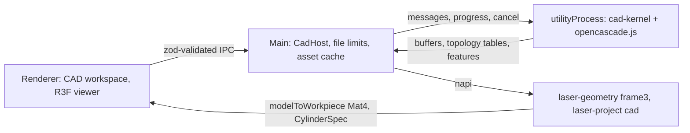

# CAD geometry architecture

Status: **[implemented]**. See [ADR 0005](../adr/0005-cad-geometry-kernel.md) for the kernel choice.

## Ownership

| Concern | Owner |
| --- | --- |
| STEP/STL/3MF parse, B-Rep, tessellation, measure, section, mesh cylinder fit | `packages/cad-kernel` (Node, utility process) |
| Timeouts, 200 MB limit, sha256 cache, cancel, `.ols` file bytes | `CadHost` (Electron main) |
| `modelToWorkpiece`, cylinder local frame, persistence schema | Rust (`laser-geometry`, `laser-project`) |
| Picking, overlays, display units | Renderer (no wasm) |

Ids are `(partPath, kind, index)` plus a geometric signature so a reimport can invalidate or remap
references. Display meshes are not authoritative: `triangleToFace` is only for picking and
highlighting.

## Kernel modules

- `step.ts` — `STEPCAFControl_Reader`, assembly tree, unit from `FileUnits`
- `brep.ts` — indexed solids/faces/edges/vertices, per-face triangulation
- `analyze` / `features.ts` — surface/curve kind, coaxial cylinder groups, holes, axis candidates
- `measure.ts` — point, length, radius, angle, face distance, area
- `section.ts` — `BRepAlgoAPI_Section` on STEP; triangle clip on meshes
- `fit.ts` — Jacobi eigensolver + algebraic circle fit for mesh cylinders
- `threemf.ts` / `mesh.ts` — 3MF ZIP+XML and STL

Every reported value carries a quality tag (`analytical` / `computed` / `mesh-derived` / `fitted`).
The kernel never falls back to “longest AABB side” for a rotary axis.
