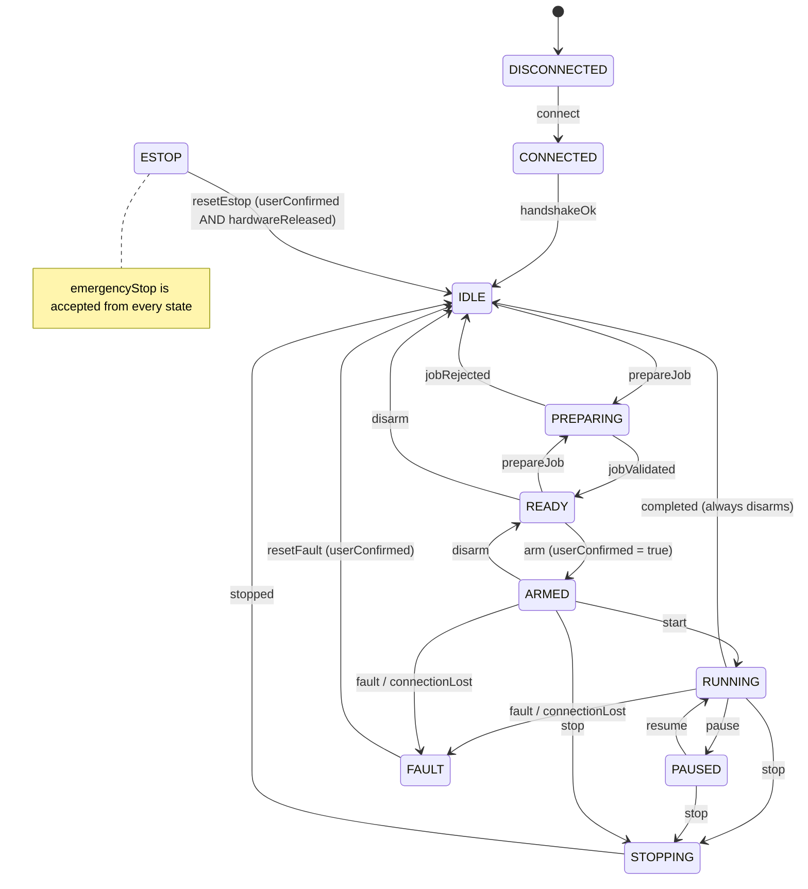

# Job execution

Status: **[sim-only]**. The job engine runs end-to-end against the simulated F1 and the virtual axis
controller. It has never driven real hardware.

## Session lifecycle (safety state machine)

The transition function is `SafetyMachine::next_state` in `crates/laser-core/src/safety.rs`. Any
transition not in the table is rejected and logged. **The laser is permitted only in `RUNNING`**
(`laser_permitted()`); every device checks this before sending anything that would emit.

## Steps

1. **connect**: the F1 handshake and the axis controller `HELLO`/`CAPS`, with a 2 s handshake timeout.
2. **home**: cylinder mode only. `ENABLE`, then `HOME axis=U`, then `STATUS` (120 s timeout).
3. **prepare**: plan the project, then check it against the machine profile: soft limits, field size,
   `simulationOnly` plans and unvalidated limits. This produces a `PrepareReport` with errors,
   warnings, the unit count and an estimate.
4. **arm**: requires an explicit confirmation. The UI uses a three-item checklist dialog.
5. **start**: the `JobRunner` walks the units. For each indexed section:

   | Step | What happens | Failure |
   | --- | --- | --- |
   | `MoveExternal` | send `MOVE A=… U=…` (laser off) | `REJ` → fault |
   | `WaitExternal` | wait for `ACC` → `STA` → `CMP` with timeout | timeout / `FLT` → fault |
   | `VerifyExternal` | `STATUS`; position within tolerance | mismatch → fault |
   | `Settle` | `externalSettleS` dwell | — |
   | `ExecuteF1` | send the section program (gated by `laser_permitted`) | refused → fault |
   | `WaitF1` | all lines acknowledged and machine idle | error reply → fault |
   | `Advance` | next unit | — |

6. **completion**: the outcome is `completed` (with duration), `failed` (with reason), `stopped` or
   `emergencyStopped`. Completing always returns to `IDLE` and disarms.

Pause is honoured **only at section boundaries**, because F1 V1 has no documented pause. Stop
aborts the current section through the device's stop path.

## Faults

Faults latch. A fault never resumes on its own. The operator must acknowledge it (`resetFault`)
and run `prepare` → `arm` → `start` again. An emergency stop additionally requires confirming
that the physical E-stop has been released. Communication loss while `ARMED`, `RUNNING`, `PAUSED`
or `STOPPING` is a fault; in any other state it just disconnects.

The simulator can inject: F1 disconnect/reconnect, axis disconnect/reconnect, axis fault (any
code), dropped completion, delayed responses, limit hit, position error and an E-stop button press.
All of these are available from the Machine panel and from `ols-sim --inject`.

## Logs

- **Protocol log**: every frame/line, with the channel, direction (tx, rx, info, error, blocked) and time.
- **Job log**: each runner step, by unit.
- **Safety history**: every transition, with its event and reason.
