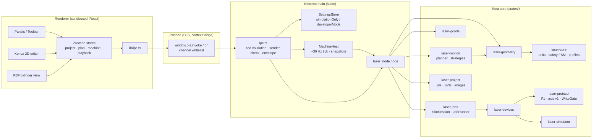
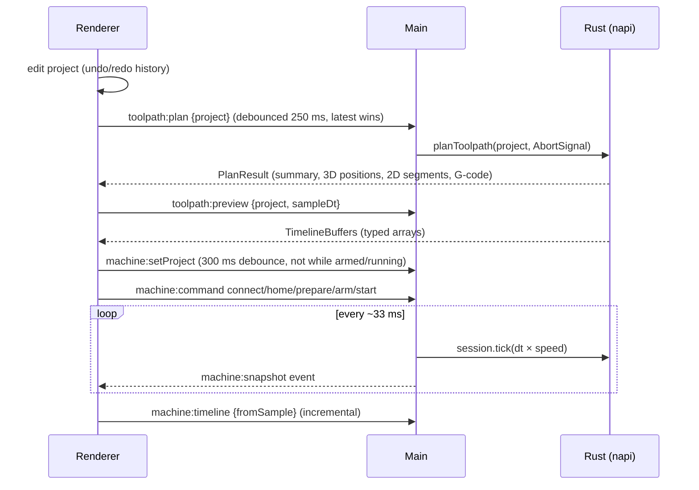

# Architecture overview

Status legend: **[implemented]** works and is covered by tests in Milestone 1 · **[sim-only]**
implemented but only exercised against simulated devices · **[planned]** not implemented.

## Processes and layers

| Layer | Responsibility | Status |
| --- | --- | --- |
| Renderer | Editing, preview, playback, presenting machine state. Never talks to devices. | [implemented] |
| Preload | Exposes exactly two functions and only whitelisted channels. | [implemented] |
| Main | Validates every request (zod), owns settings and the safety flags, hosts the simulated machine session, and gates file writes to dialog-returned paths. | [implemented] |
| `laser-core` | Units, `MachinePosition`, safety state machine, machine profile with validation. | [implemented] |
| `laser-geometry` | Path flattening, transforms, cylinder transform (surface ↔ machine ↔ 3D), mesh generation. | [implemented] |
| `laser-motion` | Toolpath planning: vector, hatch fill, raster, the indexed cylinder strategy and the coupled (experimental) strategy. Also the kinematic timeline and 3D overlays. | [implemented] |
| `laser-gcode` | Parser, validator, F1 dialect emitter and analyzer. | [implemented] |
| `laser-protocol` | F1 TCP/HTTP framing (inferred), axis protocol v1, `WriteGate`, line framer. | [implemented] (F1 framing **unvalidated**) |
| `laser-devices` | `LaserDevice` / `AxisController` traits; simulated F1; real F1 (connect/probe only); external controller over a transport. | [sim-only] |
| `laser-simulator` | Virtual F1 + virtual axis controller with fault injection and timing. | [implemented] |
| `laser-jobs` | `SimSession`, indexed job runner (barrier-synchronized), logs, outcome. | [implemented] |
| `laser-project` | `.ols` ZIP container, migrations, SVG import, image import, text-to-path. | [implemented] |
| `firmware/esp32-motion-controller` | Axis controller firmware. | skeleton; host-tested logic only |

## Data flow: design → toolpath → preview → simulated job

## Coordinate frames

The four coordinate frames are described in [MOTION_MODEL.md](MOTION_MODEL.md):
design (u, s), galvo (x, y), machine (A, U) and 3D (the cylinder's local frame). One Rust
implementation of each conversion is mirrored by `packages/geometry-adapters` for UI-only use. The two
implementations are kept in sync by `tests/fixtures/coordinates.json`, which both test suites check.

## Key decisions

See `docs/adr/`:

- [0001](../adr/0001-electron-over-tauri.md): Electron instead of Tauri.
- [0002](../adr/0002-editor-library.md): Konva for the editor.
- [0003](../adr/0003-rust-owns-geometry.md): Rust owns geometry and motion.
- [0004](../adr/0004-dependency-versions.md): pinned dependency versions.
