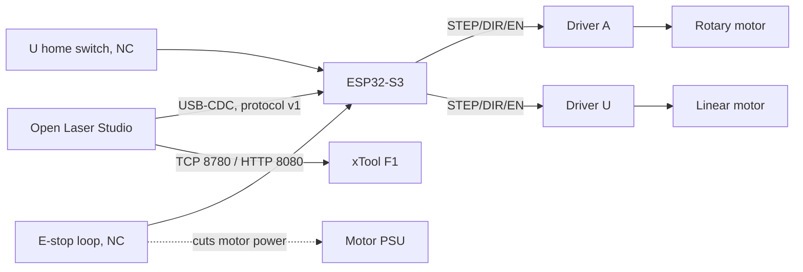

# ESP32-S3 external axis controller

Status: **firmware skeleton**. The portable logic is host-tested; the board layer has never been
compiled for or run on an ESP32-S3. Source: `firmware/esp32-motion-controller/`. Protocol:
[AXIS_CONTROLLER_PROTOCOL.md](../protocols/AXIS_CONTROLLER_PROTOCOL.md).

## Role

The controller drives the rotary **A** axis (the workpiece rotates on rollers or in a chuck) and the
linear **U** carriage (the workpiece translates along its axis under the F1's galvo field). It never
controls the laser. In the indexed strategy the controller moves only while the laser is off, and
Open Laser Studio waits for `CMP` and verifies the position with `STATUS` before each section.

## Firmware structure

| Component | Contents | Host tested |
| --- | --- | --- |
| `ols_protocol` | framing, CRC-16/CCITT-FALSE, line framer with overflow guard | yes |
| `ols_motion` | states, trapezoid profiles, homing with timeout, soft limits, E-stop/limit/driver/link faults | yes |
| `ols_board` | GPIO, GPTimer step ISR (40 kHz), debounced inputs, USB-Serial-JTAG | no (needs ESP-IDF) |
| `main` | 1 kHz control task | no |

Run the host tests with `pnpm test:firmware`. They need gcc, clang or `zig cc`.

## Mechanics (placeholders)

| Axis | Default | Formula |
| --- | --- | --- |
| A | 1.8° motor, 1/16 microstepping, 3:1 belt → 26.667 steps/deg | `steps/rev × µsteps × ratio / 360` |
| U | 1.8° motor, 1/16, T8 lead screw (8 mm/rev) → 400 steps/mm | `steps/rev × µsteps / lead` |

The calibration helper in **Setup → Calibration** computes corrected values from a commanded and a
measured move. Compile-time constants are used until the host can send calibration values to the
controller (planned).

## Bring-up checklist (not yet performed)

1. Install ESP-IDF v5.2 or later and run `idf.py set-target esp32s3 && idf.py build`.
2. Flash with **no drivers connected**. Check `HELLO`, `CAPS` and `STATUS` from a serial terminal.
3. Toggle the E-stop and limit inputs by hand. Expect `FLT` frames, and expect `RESET` to be refused while the E-stop is pressed.
4. Connect the drivers with motor power **off**. Check STEP/DIR with a logic analyzer.
5. With motor power on, no load and the E-stop within reach: `ENABLE`, small `MOVE A=10`, then `HOME axis=U`.
6. Only then connect Open Laser Studio, still in simulation-only mode, to compare timing.
