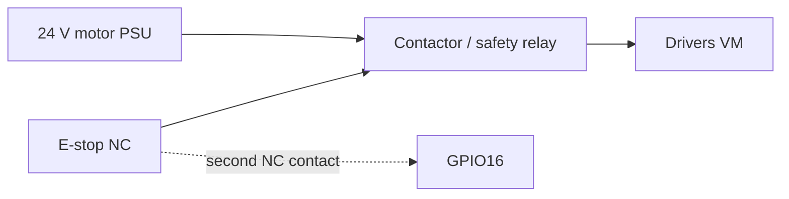

# Wiring (proposed, unvalidated)

> These pin assignments are **placeholders** for an ESP32-S3-DevKitC-1 and two STEP/DIR drivers
> (for example TMC2209 in standalone mode). Check them against your board's pinout and strapping pins
> before connecting anything. Nothing on this page has been built.

| Signal | ESP32-S3 GPIO | Direction | Notes |
| --- | --- | --- | --- |
| A STEP | 4 | out | ≥ 2 µs pulse |
| A DIR | 5 | out | |
| U STEP | 6 | out | |
| U DIR | 7 | out | |
| DRV EN (both drivers) | 15 | out | **active low**; high (disabled) at boot |
| E-stop sense | 16 | in, pull-up | NC contact to GND; **open = stop** (a broken wire reads as stop) |
| U home/limit | 17 | in, pull-up | NC switch to GND; open = triggered |
| Driver fault | 18 | in, pull-up | optional DIAG/ALARM, active low |
| USB | native USB D+/D− | — | USB-Serial-JTAG CDC to the host |

## E-stop loop

The E-stop must **break motor power through a contactor or a driver-enable relay that works without
the ESP32**. The GPIO sense line only tells the firmware that the loop is open, so that it latches
`ESTOP` and reports it. The F1 has its own emergency stop button, which must stay reachable.

## Grounding and noise

- Common ground between the ESP32 and the driver logic. Keep motor wiring away from the USB cable.
- Use shielded cable for the limit switch on long runs, and add RC filtering if false triggers appear.
- Power the ESP32 from USB, not from the motor supply, during bring-up.
